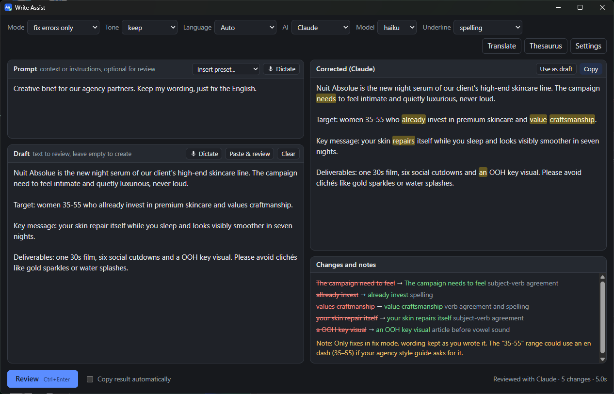

# Write Assist

**[Instrucciones en español](#en-español)**

A small Windows app that reviews and writes text with AI: messages, emails,
posts, docs. Paste what you wrote and get it proofread, or describe what you
need and get it written. It also has a context-aware thesaurus and offline
dictation, a translator, live grammar underlines, and an English or Spanish
interface. It works with
your existing Claude subscription through Claude Code, or with a **free AI that
runs on your own computer**, so there are no API keys and nothing extra to pay.
ChatGPT and GitHub Copilot plans work too.



## Install

You need **Windows 10 or 11**, and one of these:

- a **Claude Pro or Max** plan (or a Team or Enterprise seat; Claude's free
  plan doesn't include Claude Code): the best results; or
- nothing at all: the **free local AI** (Google's Gemma model, run by the free
  Ollama app) works on your computer, with no account, offline and private.
  It's a one-time download of about 5.3 GB (6.7 GB of disk space). It handles
  everyday fixes well; Claude is better with subtle wording. A review takes a
  second or two on a fast PC and up to about a minute on an older laptop.

1. Open **PowerShell** (Start, type *PowerShell*, Enter).
2. Paste this line and press Enter:

   ```powershell
   irm https://raw.githubusercontent.com/luigihmtz/write-assist/main/install.ps1 | iex
   ```

3. If neither AI is set up yet, the installer asks which one to use. For
   Claude, sign in when your browser opens.

The line downloads and runs [install.ps1](install.ps1) from this repository.
If you prefer to read a script before running it, open that file first.

The installer sets up Python (with the small pywebview package), the WebView2
runtime and the AI you chose (Claude Code, or Ollama and the Gemma model) if
they're missing, then opens Write Assist. No admin rights needed. On first launch it asks a little about
you (your languages, what you write) so it corrects and writes like you.

**Open it** from the Start Menu or with **Win+Ctrl+W** from any app. To pin it
to the taskbar: Start, right-click *Write Assist*, *Pin to taskbar*.

**Updates:** when a new version is out, an *Update to vX* button appears at
the bottom of the window. One click and it updates itself.

**Uninstall:** Settings > Apps > Write Assist > Uninstall. It also removes the
live grammar checker. Python, Claude Code and Ollama stay installed for other uses; remove Ollama and its models from
Settings > Apps > Ollama if you don't need them.

## How to use it

Fill in one or both fields. The button shows which task you'll get:

| Prompt | Draft | Task |
|---|---|---|
| – | ✓ | **Review**: proofreads the draft (grammar, typos, punctuation) |
| ✓ | ✓ | **Review**: the prompt adds context or instructions ("email to a client", "make it shorter") |
| ✓ | – | **Create**: writes the text the prompt describes |

Press **Ctrl+Enter**, then **Copy** the result.

| Control | What it does |
|---|---|
| **Prompt** | Review: optional context or instructions, e.g. "Email to a client", "Reply to my boss, make it shorter". Create: describe what to write, e.g. "Email to Sarah: the storyboard is two days late, we need the brand guidelines". *Insert preset...* adds a common one. |
| **Draft** | The text to review. Leave empty to create. |
| **Mode** | Review only (grayed out when creating). *fix and polish wording* (default): fixes errors and also smooths awkward or unclear phrasing. *fix errors only*: spelling, typos, grammar, punctuation, with minimal edits. Anything the prompt asks for overrides it. |
| **Language** | The text's language and regional variant (English US/UK, Spanish Mexico/Spain, French, Portuguese, German, Italian). Review corrects for it (e.g. US vs UK spelling); Create writes in it. *Auto* lets the AI decide from the text and your *About you*. |
| **Tone** | `keep` (default), or lean it: more formal, more casual, friendlier, more concise. |
| **AI** | Cheapest first: **Local (free)**, the AI on your computer; **Claude**; **ChatGPT** and **GitHub Copilot** if their command-line apps are installed (see *Optional AIs* below). The default is the cheapest one that's set up. Choosing *Local (free)* the first time offers its one-time download, with the size shown before anything downloads. If the chosen AI hits its usage limit, the request goes to the cheapest other one automatically and the status bar says so (turn off with `"auto_fallback": false` in `user_settings.json`). |
| **Model** | Local: `gemma3:4b` (default, about 3.3 GB), `gemma3:12b` (better, about 8 GB, for PCs with a good graphics card or lots of memory). Claude: `haiku` (default, fastest and lightest on your plan's limits), `sonnet`, `opus` (strongest). ChatGPT: `gpt-6-luna` (default, fast and affordable), `gpt-5.6-terra`. Copilot: `auto`. *Other...* lets you enter any other model name the AI accepts. |
| **Thesaurus** | Select a word (or put the cursor on it) in Prompt, Draft or the result, then click *Thesaurus* at the top or press **Ctrl+T**: meaning, synonyms and antonyms that fit your sentence. Click a synonym or antonym to **Replace** your word with it or **Search** it in turn (← goes back). You can also type any word in the panel's search box. It asks the AI only when you look something up. |
| **Underlines** | *Settings > Underline mistakes as I type*: **Off**; **Spelling only** (default: the spellchecker built into Windows, free, nothing to download); or **Spelling and grammar**, with LanguageTool, a free, open-source checker that runs on your computer (no account, nothing sent anywhere, no AI usage). It underlines spelling (red), grammar (blue) and style (purple); click one for suggestions, or *Ignore*. The first time, it asks before a one-time download of about 300 MB (about 500 MB on disk). With *Language* on Auto, each paragraph is checked in its own language. |
| **Panels** | Thesaurus and Translate open next to the text they work on, and that text stays highlighted in yellow. **⧉** detaches a panel: drag it anywhere by its title bar, and it stays open while you keep working. Drag the bottom-right corner to resize it; **⧉** again docks it. |
| **Translate** | Select text (a word, a sentence, a paragraph) in Prompt, Draft or the result, then click *Translate* at the top or press **Ctrl+Shift+T**. Pick the target language; *English ⇄ Spanish* translates English into Spanish and anything else into English. The panel shows only the translation, with the original highlighted in place. Then **Replace selection**, **Use as draft** or **Copy**. For a single word it also offers other options; click one to swap it in. With nothing selected, the panel offers a box to type or paste text into. It asks the AI only when you translate. |
| **Dictate** | Speak into Prompt or Draft; click again to stop (Esc cancels). Transcribed on your computer with faster-whisper: free, offline, private. The first time, it offers a one-time download (speech engine about 250 MB, plus the model: 465 MB for *small*). |
| **Settings** | *About you*, the global hotkey, the microphone for dictation (by default the Windows one), the speech model and language, and the interface language (English or Spanish; by default the same as Windows). |

**Review** shows the corrected text with the edits highlighted, and below it
each change (old → new) with a short reason, plus an optional note (e.g. "this
may sound blunt for a client email"). **Create** shows the new text; anything
essential missing from the prompt is left as a placeholder like `[date]`.

Shortcuts: **Ctrl+Enter** run · **Ctrl+T** thesaurus · **Ctrl+Shift+T** translate · **Ctrl+Shift+V** paste the clipboard as the
draft and review · **Ctrl+Shift+C** copy the result. *Use as draft* moves the
result into Draft, to refine it with a new prompt. The result is editable, and
emojis are kept as they are.

The Draft is only ever treated as text to correct, never as instructions:
a pasted email saying "reply ASAP with the numbers" gets proofread, not
answered.

### Optional AIs

To use one of these, install its command-line app once and sign in with your
existing account; it then appears in the AI list. Restart Write Assist after
installing.

- **ChatGPT** (a ChatGPT plan that includes Codex): in PowerShell, run
  `irm https://chatgpt.com/codex/install.ps1 | iex`, then `codex login`.
- **GitHub Copilot** (a Copilot plan): run `winget install GitHub.Copilot`,
  then `copilot` once to sign in.

Google's Gemini isn't offered: its command-line app for personal accounts was
replaced in June 2026 by one without a documented way for other apps to use it.

## Privacy

- **What you send to the AI:** the text you review, create, look up in the
  thesaurus or translate, together with your *About you*, goes to the AI you
  chose (Anthropic for Claude, OpenAI for ChatGPT, GitHub for Copilot) through its own
  command-line app, signed in with your own account. Their privacy policies
  and terms apply to it. With **Local (free)**, the text stays on your
  computer: the model runs there, through Ollama.
- **Dictation** is transcribed on your computer. Audio never leaves it.
- **Write Assist itself collects nothing:** no accounts, analytics or
  tracking. Your settings stay in `%APPDATA%\WriteAssist` on your PC. The
  only other connections it makes are the update check (it asks GitHub for
  the latest release) and the one-time downloads you agree to: the speech
  engine and model the first time you dictate, Ollama and its model when you
  set up the free local AI, and LanguageTool and Java when you turn on live
  grammar. Live grammar checks your text on your computer too.

## En español

Write Assist es una pequeña app para Windows que revisa y escribe tus textos
con IA: mensajes, correos, publicaciones. También tiene sinónimos, traductor y
dictado por voz.

**Qué necesitas**

- Una computadora con Windows 10 u 11.
- Una de estas dos IAs:
  - **Claude**, con un plan de pago (Pro o Max): da los mejores resultados.
  - **La IA local gratuita**: funciona en tu computadora, sin cuenta ni
    suscripción, sin internet y en privado. Es una descarga única de unos
    5.3 GB (ocupa unos 6.7 GB). Corrige bien lo cotidiano; Claude es mejor
    con los matices. Una revisión tarda uno o dos segundos en una PC rápida
    y hasta un minuto en una laptop más antigua.

### Instalar (unos 5 minutos, solo una vez)

1. Haz clic en el botón de **Inicio**, escribe **PowerShell** y presiona
   **Enter**. Se abre una ventana con fondo oscuro.
2. Copia esta línea completa, pégala en esa ventana (con clic derecho se
   pega) y presiona **Enter**:

   ```powershell
   irm https://raw.githubusercontent.com/luigihmtz/write-assist/main/install.ps1 | iex
   ```

3. Espera mientras se instala. Verás texto en inglés pasando por la
   pantalla; es normal, y la primera vez puede tardar unos minutos. Si
   Windows te pide permiso para instalar algo, haz clic en **Sí**.
4. Si todavía no tienes ninguna IA, el instalador te pregunta cuál usar:
   escribe **1** para Claude o **2** para la IA local gratuita y presiona
   **Enter**. Con Claude, tu navegador se abrirá para iniciar sesión: entra
   con tu cuenta de siempre y luego regresa a la ventana de PowerShell.
5. Cuando diga que terminó, presiona **Enter** para cerrarla. Write Assist
   se abre solo.
6. La primera vez te pregunta un poco sobre ti, como los idiomas en que
   escribes. Llénalo y haz clic en **Guardar**. Así escribe más como tú.

### Actualizar

1. Si Write Assist está abierto, ciérralo con la **X** de la esquina
   superior derecha.
2. Vuelve a abrirlo desde el menú Inicio, o con **tecla Windows + Ctrl + W**.
3. Si hay una versión nueva, en unos segundos aparece abajo un botón
   **Actualizar a v...** (o **Update to v...** si tu versión actual está en
   inglés).
4. Haz clic en él y luego en **Actualizar** (**Update**) para confirmar.
5. Se abre una ventana oscura que muestra el avance; no tienes que hacer
   nada ahí. Write Assist se cierra y se vuelve a abrir solo, ya
   actualizado.
6. Si esa ventana se queda abierta al final y te pide presionar Enter,
   presiona **Enter**.

### Cómo se usa

- Ábrelo desde el menú Inicio (**Write Assist**) o con **tecla Windows +
  Ctrl + W** desde cualquier lugar.
- **Para corregir un texto:** pégalo en **Borrador** y haz clic en
  **Revisar**. Luego haz clic en **Copiar** y pega el texto corregido donde
  lo necesites.
- **Para escribir algo nuevo:** deja el Borrador vacío, describe lo que
  necesitas en **Instrucciones** (por ejemplo "correo a mi casero pidiéndole
  que arregle el calentador") y haz clic en **Crear**.
- **Sinónimos** y **Traducir**, arriba a la derecha, funcionan con la
  palabra o el texto que selecciones primero.
- **Dictar** te deja hablar en lugar de escribir. La primera vez ofrece
  descargar el reconocimiento de voz (unos 700 MB, solo una vez); funciona
  sin internet y es privado.
- **Para tenerlo en la barra de tareas:** abre Inicio, haz clic derecho en
  **Write Assist** y elige **Anclar a la barra de tareas**.
- **Micrófono:** Dictar usa el micrófono predeterminado de Windows. Para usar
  otro, elígelo en **Ajustes > Micrófono para dictar**.
- **IA:** arriba eliges entre **Local (gratis)**, **Claude** y, si los
  tienes instalados, **ChatGPT** y **GitHub Copilot**. La primera vez que eliges Local (gratis), la
  app te avisa del tamaño de la descarga antes de bajar nada.
- **Subrayar errores:** en **Ajustes** eliges *No*, *Solo ortografía* (la
  opción predeterminada, integrada en Windows, sin descargas) u *Ortografía y
  gramática* (LanguageTool, gratuito y en tu computadora; haz clic en un error
  para ver sugerencias). La primera vez te avisa de la descarga (unos 300 MB)
  antes de bajar nada.
- **El idioma de la app** sigue al de Windows. Puedes cambiarlo en
  **Ajustes > Idioma de la interfaz**.

### Privacidad

El texto que revisas, creas, buscas en sinónimos o traduces se envía a la IA
que elegiste (Anthropic para Claude, OpenAI para ChatGPT, GitHub para Copilot) con tu propia
cuenta, y se rige por sus políticas. Con la IA local gratuita, tu texto no
sale de tu computadora. El dictado se procesa en tu
computadora: el audio nunca sale de ella. Write Assist no recopila nada.

### Desinstalar

Ve a **Configuración de Windows > Aplicaciones**, busca **Write Assist** y
haz clic en **Desinstalar**.

## Files

| File | Purpose |
|---|---|
| `writeAssist.pyw` | The app: the window (pywebview on WebView2) and the bridge the page calls. |
| `waCore.py` | Settings, Review/Create, Thesaurus and Translate requests to the AIs (Claude Code, Copilot CLI, Ollama), the local AI's setup, usage-limit fallback, edit highlighting, update check. |
| `waSpeech.py` | Offline dictation with faster-whisper, installed on first use. |
| `waGrammar.py` | Live grammar check with a self-hosted LanguageTool server, installed on first use. |
| `ui/` | The window's page: `index.html`, `style.css`, `app.js`, and `i18n.js` with the English and Spanish interface text. |
| `hotkeyListener.pyw` | Background listener for the global hotkey; opens or wakes the app. |
| `system_prompt.md` | Instructions for both tasks, shared by all AIs. `{{profile}}` becomes the user's *About you*. |
| `settings.json` | Shipped defaults: hotkey, AIs and models, timeout, font, prompt presets. |
| `release.json` | Product version and GitHub repo, used for updates and releases. |
| `install.ps1` | Installer and updater (see above). |
| `uninstall.ps1` | Removes the app, shortcuts and settings. |
| `release.ps1` | Publishes a new version (maintainer only). |
| `assets/writeAssist.ico` | Icon. |
| `assets/screenshot.png` | The screenshot in this README. |
| `LICENSE` | MIT license. |

Per-user files, kept across updates, in `%APPDATA%\WriteAssist\`:
`user_settings.json` (*About you*, hotkey, and any `settings.json` key to
override) and `state.json` (last-used options, window size). Installed copies
live in `%LOCALAPPDATA%\WriteAssist\`.

## How it works

The window is a local web page shown by pywebview in Microsoft's WebView2
(built into Windows 10/11); the page calls Python through
`window.pywebview.api`. Python grants the page microphone and clipboard
access without prompts.

Each run builds one request from the Prompt, Draft, Mode and Tone, adds
`system_prompt.md`, and sends it to the chosen AI's command-line tool in the
background. The AI gets no tools: it can't read files, run commands or browse.
The thesaurus and the translator are separate, small requests, sent only
when you use them, and cached for the session.

**Dictation** records in the page (MediaRecorder, webm/opus) and hands the
audio to faster-whisper on the CPU (int8). The model stays loaded while you
use it and is released after 10 idle minutes. Segments Whisper marks as
probably not speech are dropped, as are its typical phantom phrases on
near-silence ("Thank you.", "Gracias.").

**Claude:**

```
claude -p --safe-mode --no-session-persistence --model haiku --effort low
       --system-prompt <system_prompt.md> --output-format json --json-schema <schema>
```

- `--safe-mode` skips CLAUDE.md, plugins, MCP servers and hooks, so the call
  is fast (~3–6 s) and nothing from other projects leaks into it.
- `--json-schema` makes Claude return `{text, changes[], notes}`.
- Don't pass `--tools ""` together with `--json-schema`: structured output
  needs its internal tool, and the call has hung. All of Claude Code's own
  tools are denied with `--disallowed-tools` instead. This also keeps requests
  small: every loaded tool's description is sent with each request, ~22k
  tokens in total, so a review would cost ~23k input tokens instead of ~3k.

**Live grammar:** LanguageTool's open-source server runs on the user's PC
(`%LOCALAPPDATA%\WriteAssist-LanguageTool`, with a portable Eclipse Temurin
Java 21; no admin rights). It starts on the first check, on port 47615, and
stops after 15 idle minutes and when Write Assist closes. The page sends the
text about 0.7 s after typing stops; the underlines are drawn on a layer behind
the text box, with the same font and wrapping. The writer's first language
(from *About you*) is passed as `motherTongue`, which turns on LanguageTool's
false-friend rules.

**ChatGPT:** OpenAI's Codex CLI, signed in with the user's ChatGPT account:

```
codex exec - --ephemeral --ignore-user-config --ignore-rules --skip-git-repo-check
      -s read-only -C <empty temp folder> --json --output-schema <schema> -o <reply>
      -c model_instructions_file=<one line> -c web_search="disabled"
      --disable shell_tool --disable unified_exec ...   (prompt sent on stdin)
```

Codex is a coding agent, so the app swaps its long built-in instructions for a
one-line file and turns off its tools (shell, browser, images, plugins and
others). That keeps each request around 6k input tokens instead of 15k. The
schema is made strict (`additionalProperties: false`, every field required), as
OpenAI's structured output requires.

**Local (free):** Ollama's local API (`http://127.0.0.1:11434/api/chat`) with
the JSON schema as `format`, `think: false` and `temperature: 0.2`. If Ollama
isn't running, the app starts only its engine (`ollama serve`) in the
background, with no window; when Write Assist installs Ollama it removes
Ollama's own login item. The model unloads after 10 idle minutes. Small
models need things spelled out, so the app detects whether a text is English
or Spanish and names the language in the request (for Review and for
Translate's *English ⇄ Spanish*); antonyms that repeat a synonym are dropped.

**GitHub Copilot** (optional, needs `winget install GitHub.Copilot` and a
Copilot plan):

```
copilot -s --model auto --available-tools= --no-custom-instructions
        --disable-builtin-mcps --no-ask-user      (prompt sent on stdin)
```

Copilot CLI has no system-prompt or schema option, so the instructions and
JSON format go in the prompt and the reply is parsed. It has no command that
lists models: run `copilot`, type `/model`, and type a name into the Model
box. Leave its `effort` empty; `auto` rejects `--reasoning-effort`.

**Hotkey:** shortcut (.lnk) hotkeys can't use the Win key, so
`hotkeyListener.pyw` registers it with Windows and starts at login. The app
talks to it on local port 47614 to change the hotkey; the app itself listens
on 47613 so a second launch brings the open window forward.

**Updates:** the app checks the repo's latest GitHub release against
`release.json` every 6 hours. *Update* re-runs `install.ps1`, which replaces
`%LOCALAPPDATA%\WriteAssist` with the new release and restarts everything.

## Development

Clone the repo and run `.\install.ps1` from it. In a clone (a folder with
`.git`), the installer sets up shortcuts and the hotkey for that folder in
place, and the app never self-updates.

To publish a version:

1. Bump `version` and `date` in `release.json`, and add a `CHANGELOG.md` entry.
2. Commit and push to `main`.
3. Run `.\release.ps1`. It tags the commit and creates the GitHub release;
   installed copies offer the update the next time they open.

## Third-party software

Write Assist doesn't include other people's code. The installer and the app
download these from their official sources, each under its own license:

| Software | Used for | License |
|---|---|---|
| [Python](https://www.python.org) | Runs the app | PSF License |
| [pywebview](https://github.com/r0x0r/pywebview) (with pythonnet) | The window | BSD-3-Clause (pythonnet: MIT) |
| Microsoft Edge WebView2 Runtime | Shows the window's page | Microsoft software license |
| [Claude Code](https://www.anthropic.com/claude-code) | Talks to Claude | Anthropic's terms |
| [Ollama](https://ollama.com) (optional) | Runs the free local AI | MIT |
| [Gemma 3](https://ai.google.dev/gemma) models by Google (optional) | The free local AI | Gemma Terms of Use |
| [OpenAI Codex CLI](https://github.com/openai/codex) (optional) | Talks to ChatGPT | Apache-2.0 (use under OpenAI's terms) |
| [GitHub Copilot CLI](https://github.com/features/copilot) (optional) | Talks to Copilot | GitHub's terms |
| [LanguageTool](https://languagetool.org) (optional) | Live grammar check | LGPL-2.1 |
| [Eclipse Temurin](https://adoptium.net) Java 21 runtime (optional) | Runs LanguageTool | GPL-2.0 with Classpath Exception |
| [faster-whisper](https://github.com/SYSTRAN/faster-whisper) (with CTranslate2, PyAV) | Dictation | MIT (PyAV: BSD-3-Clause, with FFmpeg under LGPL) |
| [Whisper](https://github.com/openai/whisper) models by OpenAI | Dictation | MIT |

## License

Write Assist is released under the [MIT License](LICENSE): you can use, copy,
modify and share it, as long as the copyright notice stays with it. It comes
as is, without warranty of any kind.

Write Assist is an independent project, not affiliated with or endorsed by
Anthropic, OpenAI, GitHub, Microsoft, Google or Ollama. Claude, ChatGPT, GitHub
Copilot, Windows, Gemma and the other
product names mentioned are trademarks of their respective owners. Using
Claude, ChatGPT or Copilot through Write Assist is subject to your own agreement
with Anthropic, OpenAI or GitHub.
